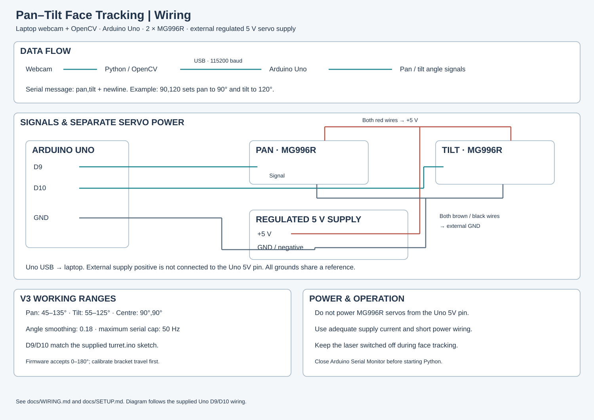

# Pan–Tilt Face Tracking

**A computer-vision tracking prototype using Python, OpenCV, Arduino Uno and two MG996R servos.**

A laptop webcam detects faces with OpenCV. Python selects a face, computes the corresponding pan/tilt commands and sends them over USB serial. The Arduino receives the angles and drives the two-axis mechanism.

Built by **Ibrahim Mallick**.



## Features

- OpenCV Haar-cascade face detection with a live annotated webcam view.
- Two-axis motion through Arduino Uno and two MG996R servos.
- Three Python versions showing the evolution of the control approach.
- V3: largest-face selection, bounded position mapping and exponential smoothing.
- V3: serial writes only when rounded angles change, with a maximum update rate of 50 Hz.
- Shared newline-delimited `pan,tilt` protocol at 115200 baud.
- A serial movement-check script and an optional configurable launcher.

## Hardware

| Component | Quantity | Role |
| --- | --- | --- |
| Arduino Uno | 1 | Serial command receiver and servo signals |
| MG996R positional servo | 2 | Pan and tilt |
| Laptop/PC webcam | 1 | Image input |
| Pan–tilt bracket | 1 | Two-axis mechanical assembly |
| External regulated 5 V supply | 1 | Servo power, with adequate peak-current capacity |
| USB cable | 1 | Laptop ↔ Arduino power/serial |
| Wiring | As required | Signals, servo supply and common ground |

## Connections

| Connection | Destination |
| --- | --- |
| Pan servo signal | Uno D9 |
| Tilt servo signal | Uno D10 |
| Both servo red wires | External 5 V positive |
| Both servo brown/black wires | External supply ground |
| Uno GND | External supply ground |
| Uno USB | Laptop |

Use a suitable external supply for the MG996R pair; do not power them from the Uno 5V pin. Keep the laser switched off during face-tracking tests. See [WIRING.md](docs/WIRING.md).

## Quick start

1. In Arduino IDE open `firmware/turret/turret.ino`.
2. Select **Arduino Uno**, choose its port and upload.
3. Close Arduino Serial Monitor.
4. Open a terminal in `python/` and install dependencies:

```sh
python -m pip install -r requirements.txt
```

5. Set `COM_PORT` in `face_tracking_v3.py` to your Arduino's port. Its supplied value is `COM9`.
6. Run:

```sh
python face_tracking_v3.py
```

Press **Q** or **Esc** to quit. V3 sends `90,90` on normal exit.

Full setup and calibration: [SETUP.md](docs/SETUP.md).

## Python versions

| File | Behaviour |
| --- | --- |
| `python/versions/face_tracking.py` | First detected face, 25-pixel dead zone and one-degree incremental commands |
| `python/versions/face_tracking_v2.py` | Largest face, coordinate smoothing, dead zone, proportional increments, step limits and return-to-centre after loss |
| `python/face_tracking_v3.py` | Largest face, direct coordinate-to-angle mapping, bounded travel, smoothed angles and change-only serial writes |
| `python/serial_test.py` | Sends a sequence of positions to check the serial link and servo axes |
| `python/track.py` | Optional launcher using V3's mapping, with command-line port selection, preview, axis inversion and cleanup |

The four uploaded scripts are preserved byte-for-byte. `turret.ino` is the supplied Arduino sketch. `track.py` and `control.py` provide a separate configurable entry point.

## V3 defaults

| Setting | Value |
| --- | --- |
| Serial port / baud | `COM9` / 115200 |
| Camera index | 0 |
| Requested image size | 640×480 |
| Pan centre / travel | 90° / 45–135° |
| Tilt centre / travel | 90° / 55–125° |
| Smoothing | 0.18 |
| Maximum serial update rate | 50 Hz; actual rate depends on frame processing and angle changes |
| Face-selection rule | Largest detection in each frame |
| Face loss in V3 | Hold the last commanded position |

V3 maps image position to an angle setpoint. Its smoothing is an exponential approach to that setpoint; it is not a full PID or Kalman estimator. The separate vision/estimation upgrade is a different project.

## Optional configurable launcher

```sh
python track.py --list-ports
python track.py --preview
python track.py --port COM9
python track.py --port COM9 --invert-tilt
```

Linux example: `python track.py --port /dev/ttyACM0`.

`--preview` opens the camera without sending servo commands. **C** centres the commands, **Q/Esc** exits. Like V3, missing faces hold position; cleanup requests centre before closing serial.

## Serial format

Each message contains two integer angles and a newline:

```text
90,120
```

The actual transmitted bytes are `90,120\n`. Firmware constrains both commands to 0–180°. Python V3 applies its narrower working ranges. Calibrate mechanical travel before running the earlier versions or the movement check.

## Repository

- `firmware/turret/`: Arduino IDE sketch.
- `python/`: V3, serial check, dependencies and optional launcher.
- `python/versions/`: earlier tracking iterations.
- `docs/`: setup, wiring, usage and GitHub publishing instructions.
- `tests/`: angle-mapping and configuration checks for the optional launcher.

## Usage notes

Haar-cascade detection works best with a reasonably frontal, well-lit face. The largest-face rule can switch targets when several faces are present; this is not identity recognition. Requested camera size and update cap are configuration values, not guaranteed measured performance. Camera/servo placement and axis polarity determine the required mapping calibration.

The servo commands are angle setpoints; there is no measured servo-position feedback in this project. Keep the mechanism clear during centring and calibration, and keep the laser off when tracking faces.
